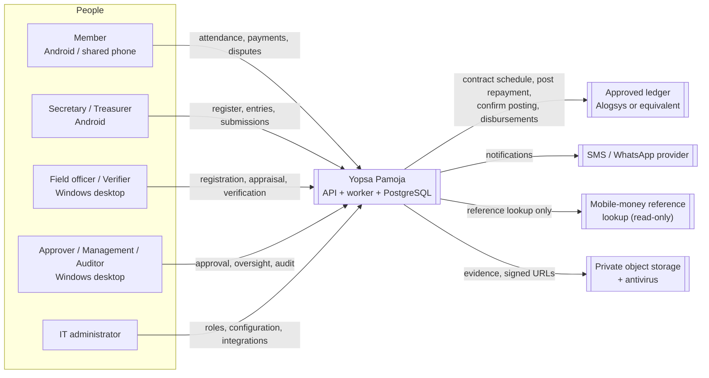
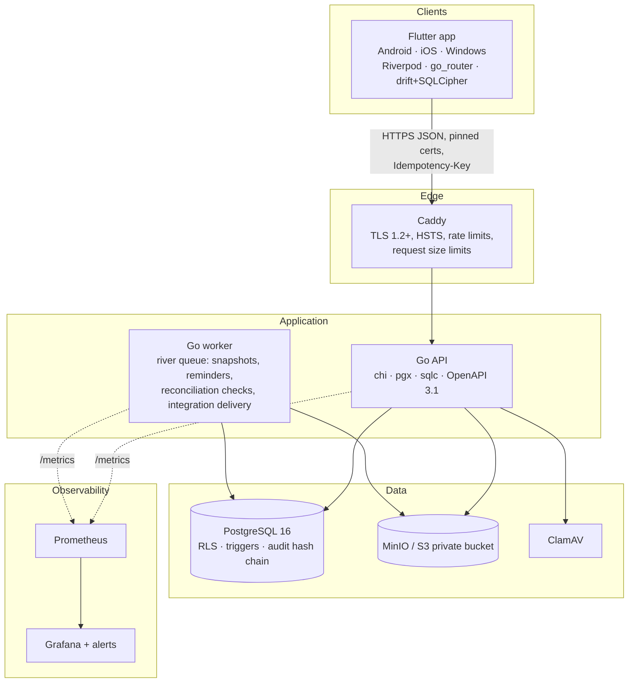
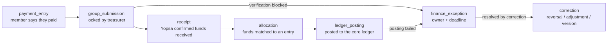
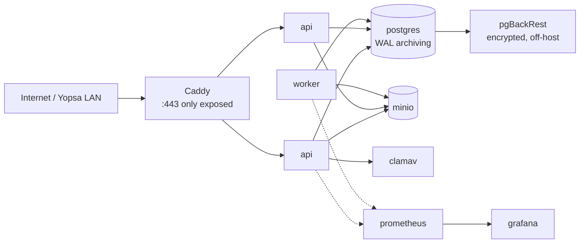

# Architecture

**Status:** P0 baseline — delivered for approval. Implementation status per
component is in [§14](#14-implementation-status).
**Source:** Yopsa Pamoja Concept Document v1.0 (31 October 2026).

## 1. Purpose and boundaries

Pamoja is an internal **Group Management and Financial Monitoring System** for
Yopsa Microfinance. It serves VSLAs, investment clubs, associations,
cooperatives and SACCOs.

It **complements** Yopsa's approved financial ledger (Alogsys or equivalent)
and never replaces it:

| Pamoja owns | The core ledger owns |
|---|---|
| Group, member, membership and authority records | Contractual loan schedules |
| Meeting registers, attendance, minutes, resolutions | Posted balances and accounting entries |
| Payment entries recorded from members, submissions, receipts | Authoritative loan balances |
| Verification, allocation and correction workflow | Disbursement accounting |
| Dashboards, ranking, learning, disputes, tasks | Statutory reporting |

Three financial facts are always kept distinct, in three record types
(see [§6](#6-the-three-financial-facts)):

1. money **collected from a member**,
2. money **actually received by Yopsa**,
3. money **allocated and posted to an obligation**.

A treasurer holding cash has not created a Yopsa receipt. Pending entries never
reduce an authoritative loan balance.

### Non-goals

- Pamoja is not a wallet, does not initiate mobile-money payments and does not
  hold money.
- Pamoja does not replace reconciliation, borrower checks, credit judgement or
  independent review; it enforces the workflows around them.
- No facial recognition, no continuous location tracking, no public
  leaderboard, no numeric credit score.

## 2. System context



Trust boundary: the Flutter client is **untrusted**. Every rule is enforced in
the Go service, again by PostgreSQL row-level security, and again by database
constraints and triggers.

## 3. Containers



The API and the worker share one codebase, one schema and one authorisation
engine. The worker performs only work that is safe to retry; it never decides
an approval or a verification.

## 4. Backend module map and dependency rules

```
cmd/api        HTTP entry point: config, pool, router, graceful shutdown
cmd/worker     job runner (river), scheduled jobs
cmd/migrate    schema migrations (golang-migrate)

internal/platform     config, logging, ids (UUIDv7), clock, errors, telemetry
internal/httpapi      router, middleware, route registry, JSON encoding
internal/rbac         Authorize + separation of duties + generated matrix
internal/audit        append-only hash-chained audit log
internal/auth         Argon2id, TOTP, sessions, refresh families, step-up
internal/groups       legal entity, branch, group, membership, authority, consent
internal/meetings     meetings, register, minutes, resolutions, action items
internal/payments     entries, submissions, receipts, allocations, corrections
internal/loans        applications, appraisals, decisions, offers, disbursements
internal/dashboard    cards, drill-downs, snapshots
internal/ranking      policy, eligibility, scoring, snapshots
internal/learning     items, assignments, progress
internal/comments     comments and moderation
internal/disputes     attendance and payment disputes
internal/notifications tasks, in-app alerts, provider adapters
internal/ledger       LedgerAdapter + sandbox implementation
internal/storage      object storage, signed URLs, scanning, EXIF stripping
```

Dependency rules (enforced by `depguard` as packages land):

1. `platform` imports nothing from `internal`.
2. A domain package may import `platform`, `rbac` and `audit`, and interfaces
   it declares itself for other domains. It never imports another domain's
   storage or handlers.
3. `httpapi` imports domain packages; domains never import `httpapi`.
4. No package imports `cmd/*`.

## 5. Request lifecycle

Every authenticated request follows the same path. There is no shortcut.

1. **TLS and edge**: Caddy terminates TLS, applies HSTS, rate limits and body
   limits.
2. **Correlation**: `X-Request-ID` is accepted or generated (UUIDv7) and echoed.
3. **Authentication**: the access token is verified (signature, expiry, issuer,
   audience, session family not revoked). The actor and the scopes of the
   current session are loaded.
4. **Authorisation**: the handler calls
   `rbac.Authorize(actor, module, action, resource)`. A denial is `403` and is
   audited. No handler may read or write domain data before this returns allow.
5. **Separation of duties**: actions that involve other people call
   `rbac.CheckSeparation(actorID, module, action, context)` with the identities
   involved (recorder, approver, applicant, …). A violation is `403`.
6. **Validation**: strict JSON decoding (unknown fields rejected), size limits,
   `go-playground/validator` on the decoded struct, domain invariants.
7. **Idempotency**: state-changing requests require `Idempotency-Key`. The key
   plus a hash of the canonical request is stored. Same key + same payload
   replays the stored response; same key + different payload is `409`.
8. **Transaction with scope**: the service opens a transaction, sets the RLS
   session variables, and performs the work:
   ```sql
   BEGIN;
   SELECT set_config('pamoja.actor_id',  $1, true),
          set_config('pamoja.scope_ids', $2, true),   -- CSV of scope refs
          set_config('pamoja.request_id', $3, true);
   -- statements run under RLS policies that read these settings
   COMMIT;
   ```
9. **Audit**: the same transaction appends audit rows, including the actor, the
   role and scope used, the action, before/after (redacted), the reason and the
   correlation id.
10. **Response**: JSON with the correlation id. Errors are generic to the
    caller; detail goes to the audit log.

The database role used by the API is **not** a superuser, **not** the table
owner, and **not** `BYPASSRLS`. Migrations run as a separate owner role.

## 6. The three financial facts



| Record | Means | Who creates it | What it may change |
|---|---|---|---|
| `payment_entry` | A member reports paying a category amount | Treasurer (self or assisted) | Nothing once the submission is locked |
| `group_submission` | The group's locked, declared total for a period | Treasurer | Immutable after lock; reopened only by controlled correction |
| `receipt` | Yopsa confirmed funds actually arrived | Verifier / Finance | Never edited; voided by a linked correction |
| `allocation` | A receipt amount matched to a specific entry | Verifier / Finance | Never edited; corrected by linked adjustment |
| `ledger_posting` | The allocation was posted to the core ledger | System, confirmed by Finance | Status only, with attempts and errors recorded |
| `finance_exception` | Something does not reconcile | System or reviewer | Closed only with a resolution note and resolver |

Invariants (enforced by the service **and** by PostgreSQL):

- `SUM(allocation.amount) <= receipt.amount` per receipt.
- A submission's declared total must equal the sum of its entries.
- A shortage is never spread automatically. Partial verification is allowed
  only for entries that are fully evidenced, and each such decision is logged.
- `receipt.amount` is the only amount that may be allocated; pending entries are
  invisible to balance calculations.
- Verified-but-unposted money is reported as **Posting pending**, never as
  posted.

## 7. Tenancy, scoping and row-level security

Scopes are hierarchical: `legal_entity → branch → group`, plus the member's
`self`.

- Role grants carry `(role, legal_entity, branch?, group?, effective_from,
  effective_to)`; they are audited and require a second administrator.
- Every scoped table has `legal_entity_id`, `branch_id` and (where relevant)
  `group_id` columns and an RLS policy that requires the row's scope to appear
  in `pamoja.scope_ids`.
- Audit, receipts, allocations, postings and corrections are append-only.
- Reports are reproducible as of a date: memberships and branch assignments are
  end-dated, never deleted.

## 8. Identity and sessions

| Concern | Design |
|---|---|
| Password hashing | Argon2id, parameters documented and tuned on target hardware; rehash on login when parameters change |
| Staff MFA | TOTP mandatory for every staff role and approver; hashed single-use recovery codes |
| Members | Phone + PIN/password, optional SMS OTP through the provider adapter |
| Access token | JWT, ≤ 15 minutes, audience-bound, carries session id and scope set |
| Refresh token | Opaque, rotated on every use, stored hashed; reuse revokes the whole family |
| Step-up | Fresh MFA within the configured window before verify, approve, disburse, role change, correction, export |
| Devices | Sessions listable and revocable per device; shared-phone mode has a short idle lock |
| Lockout | Exponential backoff, generic errors, constant-time comparisons, no user enumeration |

## 9. Offline and sync

- Offline drafts only: attendance check-in, comments, payment entries.
- Each draft carries a client UUID (UUIDv7) and an idempotency key, is stored in
  the encrypted local database (drift + SQLCipher, key in secure storage) and is
  visibly **Pending sync**.
- Outbox pattern: background sync with exponential backoff. The server
  revalidates everything; a client is never trusted.
- **Verification, approval, disbursement and posting always require the
  server** and are never offered offline.
- Conflicts are detected by version number and queued for human review; nothing
  is silently overwritten.
- Shared phone: per-user encrypted partitions, wipe on logout or remote
  revocation at next sync, short idle lock.

## 10. Integrations

- **LedgerAdapter** interface: `GetContractSchedule`, `GetBalances`,
  `PostRepayment`, `ConfirmPosting`, `ListDisbursements`.
  - Sandbox implementation backed by PostgreSQL tables — fully working, used by
    development, tests and the demo.
  - Alogsys connector: config-driven mapping skeleton; the exact endpoints Yopsa
    must obtain are listed in [ASSUMPTIONS.md](ASSUMPTIONS.md).
- Provider-neutral adapters with contract tests: SMS/WhatsApp, mobile-money
  **reference lookup only** (read-only, no initiation, no wallets), email.
- Inbound messages enter an idempotent, logged ingestion queue and surface in a
  back-office integration exceptions view. Webhooks verify signature, timestamp
  and replay protection.

## 11. Observability

- Structured JSON logs, no personal data, with redaction on sensitive attribute
  names (`internal/platform/logging`).
- Prometheus metrics: request latency/rate/errors, DB pool, queue depth, failed
  postings, posting-pending age, audit-chain integrity, backup success.
- OpenTelemetry traces across HTTP, database and adapter calls.
- `/healthz` (liveness, no dependencies) and `/readyz` (database and schema).
- Alerts: availability, p95 latency, error rate, queue depth, posting failures,
  audit-chain break, backup failure, certificate expiry, disk usage.

## 12. Deployment topology



Environments: `dev` (compose, mock providers, seeded demo data), `staging`
(production-like, synthetic data), `prod` (single host compose; optional
Kubernetes manifests). Only the reverse proxy is exposed; app containers run
non-root with read-only root filesystems and resource limits.

## 13. Technology decisions

| Decision | Record |
|---|---|
| Monorepo with Go backend, Flutter client, docs and deploy assets | [ADR-0001](ADR/0001-monorepo.md) |
| Go + chi + pgx/sqlc + golang-migrate + slog | [ADR-0002](ADR/0002-go-service-stack.md) |
| PostgreSQL RLS with separate owner and application roles | [ADR-0003](ADR/0003-postgres-rls-and-roles.md) |
| Append-only audit log with a SHA-256 hash chain | [ADR-0004](ADR/0004-audit-hash-chain.md) |
| Flutter + Riverpod + go_router + drift/SQLCipher | [ADR-0005](ADR/0005-flutter-client.md) |
| PostgreSQL-backed job queue (river) instead of a broker | [ADR-0006](ADR/0006-postgres-job-queue.md) |
| Application-level envelope encryption behind a KeyProvider | [ADR-0007](ADR/0007-envelope-encryption.md) |
| Working sandbox LedgerAdapter plus an Alogsys connector skeleton | [ADR-0008](ADR/0008-ledger-adapter.md) |
| Money as BIGINT whole UGX | [ADR-0009](ADR/0009-money-representation.md) |
| Versioned policy configuration instead of hard-coded rules | [ADR-0010](ADR/0010-versioned-policy-config.md) |

## 14. Implementation status

| Component | Phase | Status |
|---|---|---|
| Configuration, structured logging with redaction, security headers, correlation ids, health probes | P0 | Implemented and tested |
| Machine-checked RBAC matrix, authorisation engine, separation-of-duties engine, generated docs | P0 | Implemented and tested |
| Route registry with authorisation coverage test | P0 | Implemented and tested |
| PostgreSQL baseline (schema, extensions, migration ledger) | P0 | Implemented, applied by the dev stack |
| API landing/status page and OpenAPI skeleton | P0 | Implemented |
| Flutter client shell (theme, routing, home scaffold) | P0 | Skeleton, not compiled here (no Flutter SDK in this environment) |
| CI pipeline skeleton, Makefile, dev compose | P0 | Written; pipeline runs on GitHub, not verified here |
| Authentication, sessions, step-up | P1 | Not started |
| RLS policies, audit chain, idempotency store, storage service | P1 | Not started |
| Domain modules, dashboards, offline sync, hardening, deployment | P2–P10 | Not started |

## 15. Open questions for approval

Every unresolved policy value is tracked in
[ASSUMPTIONS.md](ASSUMPTIONS.md). The ones that block later phases:

- Legal entity and branch structure (A-001).
- Photo policy per platform (A-005).
- Product limits and approval authorities (A-004).
- Ranking activation (A-012).
- Retention periods and RPO/RTO (A-006, A-007).
