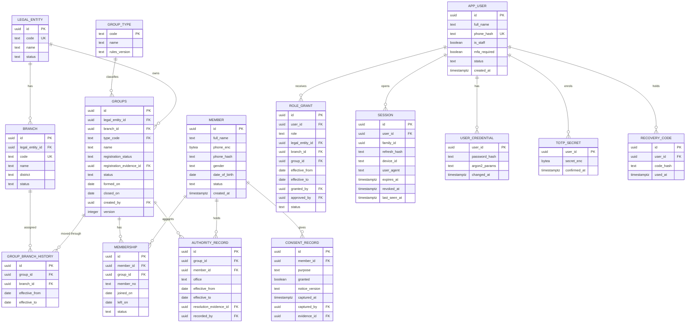
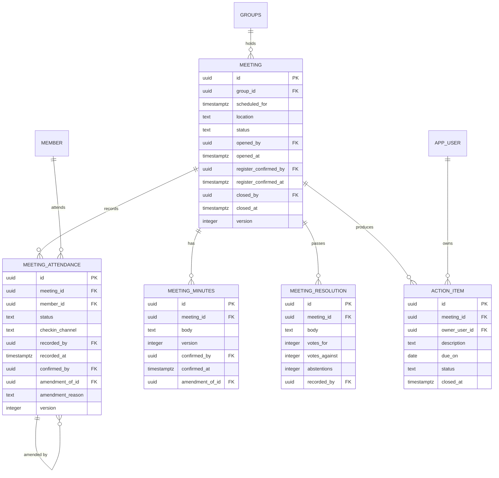
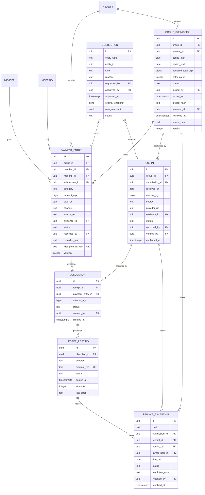
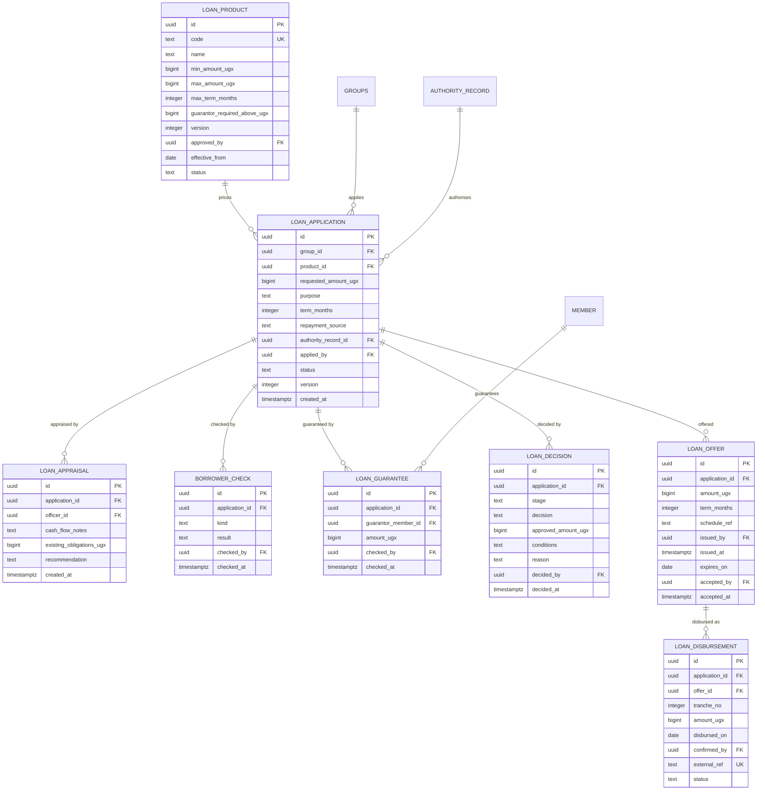
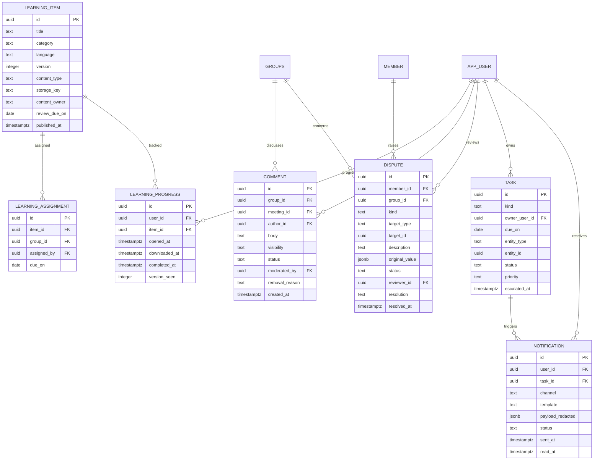
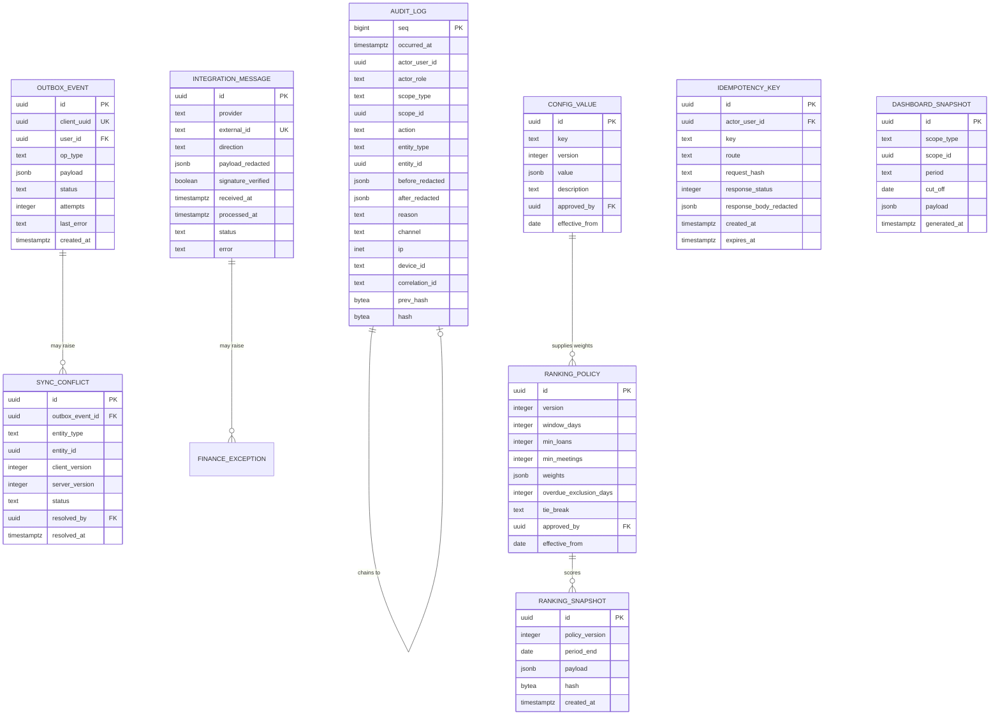

# Entity-relationship model

**Status:** P0 logical model — delivered for approval. Physical DDL lands in
P1–P5; every table below carries the scope columns and audit trail described in
[ARCHITECTURE.md](ARCHITECTURE.md).

The model is split by domain so each diagram stays readable. Tables shared
between diagrams are drawn once and referenced by name.

## Conventions

| Concern | Rule |
|---|---|
| Money | `BIGINT` in **whole UGX**. Never float, never decimal. `CHECK (amount_ugx > 0)` on every amount. |
| Identifiers | `UUID` **v7**, generated server-side. Never expose sequential ids. |
| Time | `timestamptz`, stored UTC, rendered in Africa/Kampala. Business dates are `date`. |
| Enumerations | `text` + `CHECK` constraint, never a database enum type (migrations stay simple). |
| Scope | Every scoped table carries `legal_entity_id`, `branch_id` and (where relevant) `group_id`, with RLS policies. |
| History | Financial and audit rows are append-only. Membership and branch assignment are end-dated, never deleted. |
| Optimistic locking | `version integer NOT NULL DEFAULT 1` on every mutable workflow row; updates are `WHERE id = $1 AND version = $2`. |
| Audit | Every state change writes an `audit_log` row in the same transaction. |
| Idempotency | Every state-changing request stores an `idempotency_key` row with a canonical request hash. |

## 1. Identity, organisation and authority

**Notes**

- `groups` is plural because `group` is a reserved SQL word.
- A group type label never proves legal registration: `registration_status` and
  `registration_evidence_id` are separate, and the lifecycle gate requires
  review by someone other than the creator.
- `phone_enc` is envelope-encrypted; `phone_hash` is a keyed hash used for
  lookup and duplicate detection without exposing the number.
- A role grant is only valid inside its scope and date range; `approved_by` is
  the second administrator required by SD-10.

## 2. Meetings, attendance, minutes

**Attendance formulas** (unit-tested in P3):

- Individual % = meetings attended ÷ eligible expected meetings × 100.
  Eligible = meetings on or after `joined_on`, on or before `left_on`, not
  cancelled, and (for the group's configured policy) late/excused treated as
  configured. Zero expected meetings ⇒ **"Not applicable"**, never 0% or 100%.
- Group % = Σ attended member-meeting opportunities ÷ Σ expected opportunities.
  It is **never** the average of individual percentages.
- Amendments keep `amendment_of_id`, `amendment_reason`, the reviewer and the
  timestamp; the original row is never overwritten.

## 3. Payments, receipts and reconciliation

**Database-enforced invariants**

| Invariant | Mechanism |
|---|---|
| Allocation total never exceeds the confirmed receipt | trigger on `allocation` (INSERT/UPDATE) + `CHECK (amount_ugx > 0)` |
| Submission total equals the sum of its entries | trigger on lock; `locked_hash` pins the entry set |
| Locked/verified rows cannot be edited or deleted | trigger + revoked `UPDATE`/`DELETE` for the API role |
| Only valid workflow transitions | transition trigger per table |
| A receipt source reference is unique | `UNIQUE (source, provider_ref)` |
| Pending entries never affect balances | balances are derived from postings only, never from entries |
| Corrections are linked, never destructive | `correction` rows + immutable originals |

**Verification rules**

- The verifier must be independent of the treasurer and of every recorder of
  the entries in the submission (SD-01, SD-02).
- A screenshot is not verification. A receipt needs a source reference and an
  evidence record; a cash path needs a receipt, a handover and a deposit
  reconciliation performed by different people.
- A 200,000 declared / 180,000 received case shows a 20,000 difference, blocks
  full verification, and is resolved only by locating funds or by a logged
  partial verification of fully evidenced entries. **The shortage is never
  spread automatically.**
- Verification succeeded but posting failed ⇒ status **Posting pending** plus an
  auto-created finance exception with owner and deadline.

## 4. Group borrowing

**Rules**

- Only a group's authorised representative, with an authority record valid on
  the application date, may bind the group.
- Every application passes the mandatory **operations review** before a decision.
- Approval ≠ disbursement. A loan counts as advanced only after a confirmed
  disbursement by Finance, independent of the approver (SD-04).
- A guarantor check is required above the configured threshold
  (UGX 500,000, A-003). Product limits and approval authorities come from
  versioned, approved configuration — never inferred from another product.
- Material change after approval forces re-approval.
- Group loans to groups and internal member loans are separate workflows and
  separate data; they are never summed.

## 5. Learning, comments, disputes, tasks, notifications

**Rules**

- Opening or downloading a learning item is recorded separately from
  completion. Completion never clears arrears and never changes lending
  eligibility.
- Disputes retain the original value, the member's reason, the reviewer and the
  time. Resolution never overwrites the disputed record.
- Every notification and task has an owner and a deadline — both `NOT NULL`, and
  a trigger rejects an insert without them.

## 6. Platform: audit, idempotency, sync, configuration, snapshots

**Rules**

- `audit_log` is append-only. `hash = SHA-256(prev_hash || canonical_row)`; a
  verifier command walks the chain, and a scheduled job alerts on any break.
  The latest hash is periodically anchored to an external write-once location.
- `idempotency_key` is unique per `(actor_user_id, key)`. Same key + same
  request hash replays the stored response; same key + different payload is
  `409`.
- `outbox_event.client_uuid` is the client-generated idempotency anchor for
  offline drafts; a duplicate sync is a no-op.
- `config_value` is the storage for [ASSUMPTIONS.md](ASSUMPTIONS.md): every
  policy value is versioned, dated and approved. A code constant is never the
  source of a policy rule.
- Ranking and dashboard snapshots store the policy version and the exact inputs
  so any historical ranking can be reproduced and defended.
