# State machines

**Status:** P0 — delivered for approval. Each transition below is logged with
actor, role, scope, reason and correlation id, and is enforced by a PostgreSQL
transition trigger as well as by the service layer.

Reading the diagrams: `[*]` is the initial state; labels name the actor and the
guard that must hold. An action not drawn is not permitted.

## 1. Group lifecycle

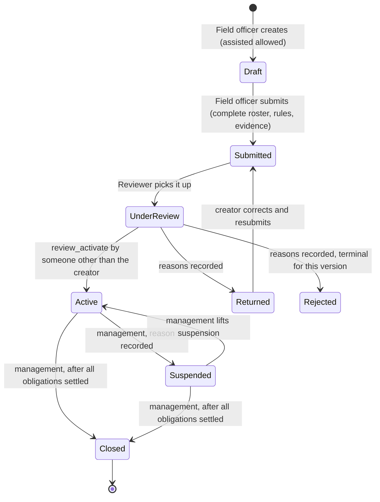

| Transition | Actor | Guard |
|---|---|---|
| Draft → Submitted | Field officer (creator) | profile complete, ≥1 member, rules document attached, consent recorded |
| UnderReview → Active | `credit_approver` | SD-06: reviewer ≠ creator; duplicate and obligation checks recorded |
| UnderReview → Returned | `credit_approver` | reason required |
| UnderReview → Rejected | `credit_approver` | reason required |
| Active → Suspended | `management` | reason required |
| Active/Suspended → Closed | `management` | no open loans, no unallocated receipts, final report stored |

## 2. Meeting and register

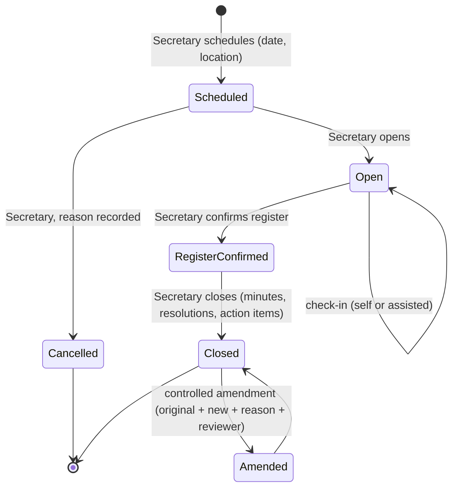

| Transition | Actor | Guard |
|---|---|---|
| Scheduled → Open | `secretary` | date reached (configurable grace), not cancelled |
| check-in | member (self) or `secretary`/`field_officer` (assisted) | member active on the meeting date; assisted actions record the acting person and the member's confirmation method |
| Open → RegisterConfirmed | `secretary` | at least one attendance row; no unconfirmed amendment |
| RegisterConfirmed → Closed | `secretary` | minutes saved; every action item has an owner and a deadline |
| Closed → Amended | `secretary` | SD-09: a different reviewer approves; original, new value, reason and timestamp retained |

Photos never prove attendance and are only accepted when the group's configured
photo policy permits them.

## 3. Attendance record

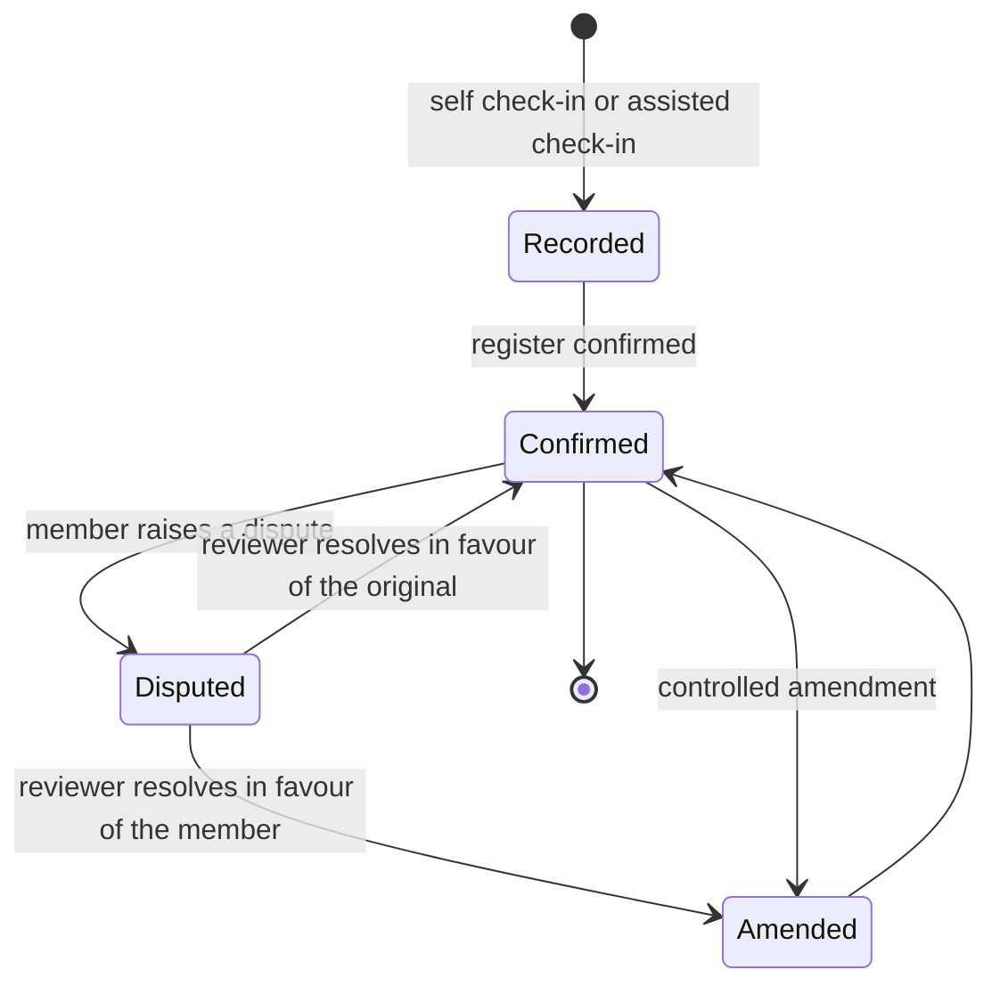

An amendment is a **new row** linked by `amendment_of_id`; the original is never
edited.

## 4. Payment entry

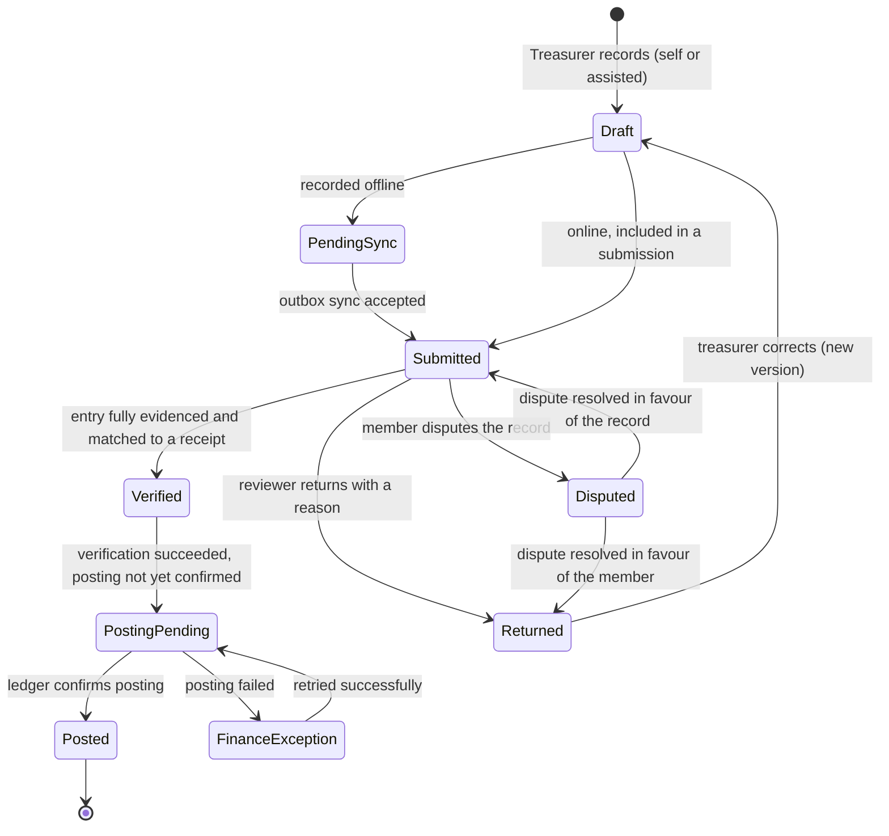

Pending, returned and disputed entries never change an authoritative balance.

## 5. Group submission, receipt, allocation, posting

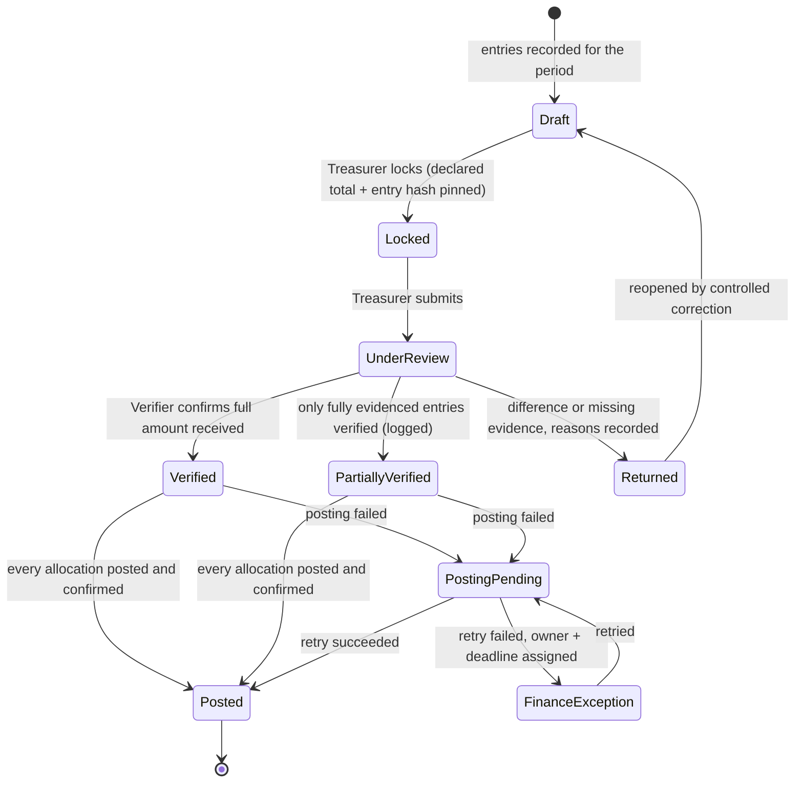

| Transition | Actor | Guard |
|---|---|---|
| Draft → Locked | `treasurer` | declared total = Σ entries; entry set hashed into `locked_hash` |
| Locked → UnderReview | `treasurer` | at least one entry; period not already submitted |
| UnderReview → Verified | `verifier` | SD-01/SD-02: verifier is not the treasurer or any recorder; received amount = declared total; receipt evidence present |
| UnderReview → PartiallyVerified | `verifier` | difference exists; every verified entry individually evidenced; decision and amount logged; **no automatic spreading** |
| UnderReview → Returned | `verifier` | reason required; difference shown exactly |
| → Posted | system, confirmed by `verifier` | every allocation has a confirmed ledger posting |
| → FinanceException | system | posting failed after verification; exception carries owner and deadline |

**Receipt** states: `Recorded → Confirmed → Voided (by linked correction)`.
A receipt is never edited. Its `UNIQUE (source, provider_ref)` makes a duplicate
provider callback a no-op.

**Allocation** states: `Created → Posted | Failed`, with a trigger enforcing
`Σ allocations ≤ receipt.amount`.

## 6. Finance exception

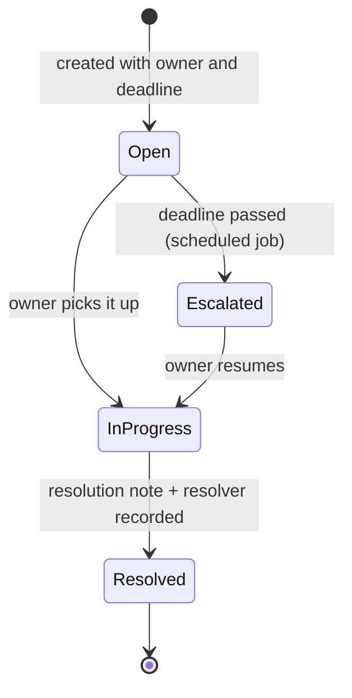

## 7. Group borrowing

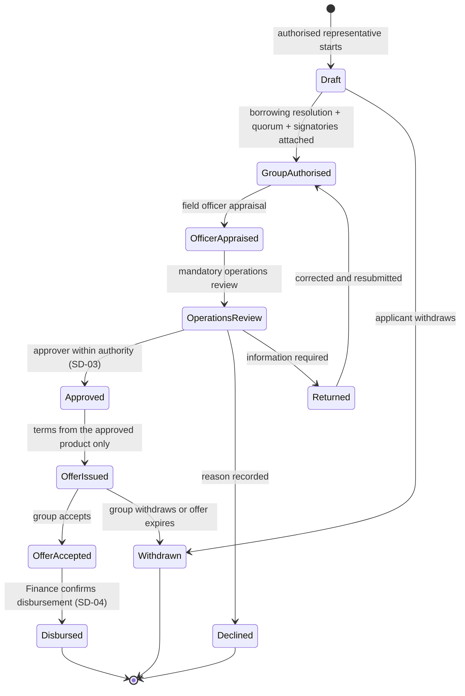

| Transition | Actor | Guard |
|---|---|---|
| Draft → GroupAuthorised | `chairperson` (or another authorised representative) | authority record valid on the application date; resolution, quorum evidence and signatories attached |
| GroupAuthorised → OfficerAppraised | `field_officer` | borrower check recorded; existing obligations and affordability recorded |
| OfficerAppraised → OperationsReview | `credit_approver` | appraisal complete; SD-05 applies at review |
| OperationsReview → Approved | `credit_approver` | amount within product limit and approver's authority; guarantor check when above the threshold (A-003); SD-03 |
| Approved → OfferIssued | `credit_approver` | terms come from the approved product version, never inferred |
| OfferIssued → OfferAccepted | `chairperson` | offer not expired |
| OfferAccepted → Disbursed | `verifier` (Finance) | SD-04: disburser ≠ approver; external reference recorded |
| any → Re-approval | system | material change (amount, term, security, guarantors) after approval resets to `OperationsReview` |

`Approved` but not `Disbursed` is **not** counted as a loan advanced anywhere.

## 8. Dispute

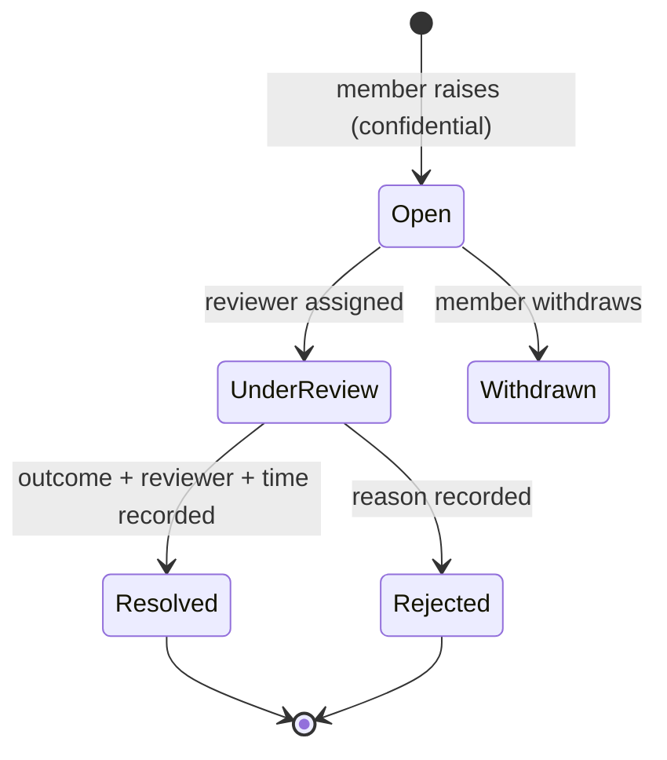

The disputed record keeps its original value throughout; the resolution is a
linked record.

## 9. Correction

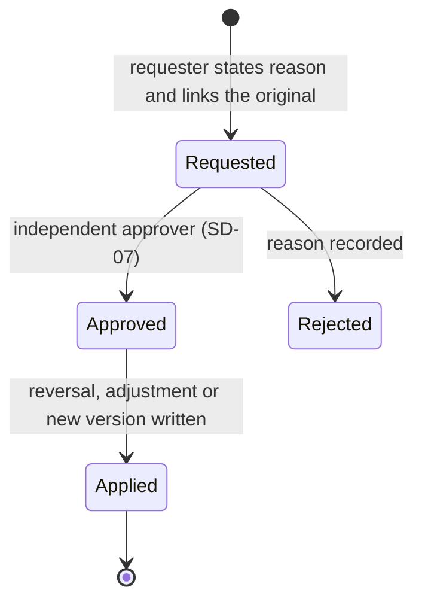

## 10. Task and notification

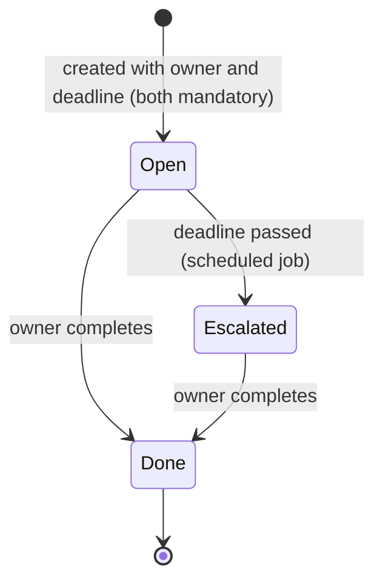

A task row cannot be inserted without `owner_user_id` and `due_on`; a trigger
rejects it. The same applies to every notification's originating task.

## 11. Role grant

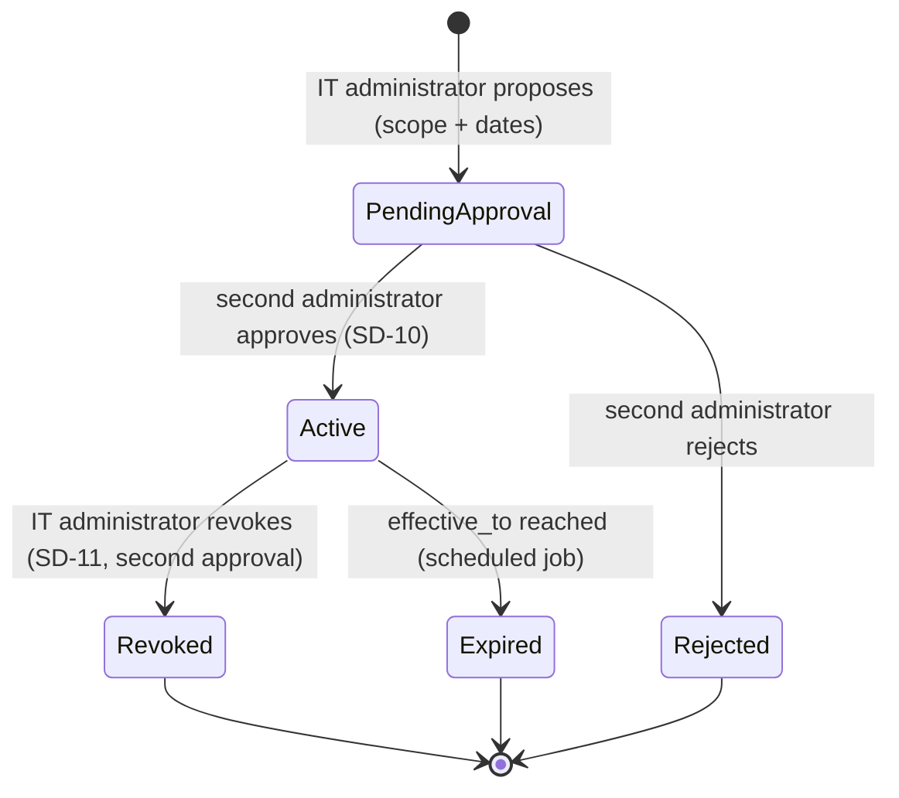

An IT administrator cannot grant themselves anything: SD-10/SD-11 require a
different administrator, and no role that can handle finance is grantable
without that second approval.

## 12. Refresh token family

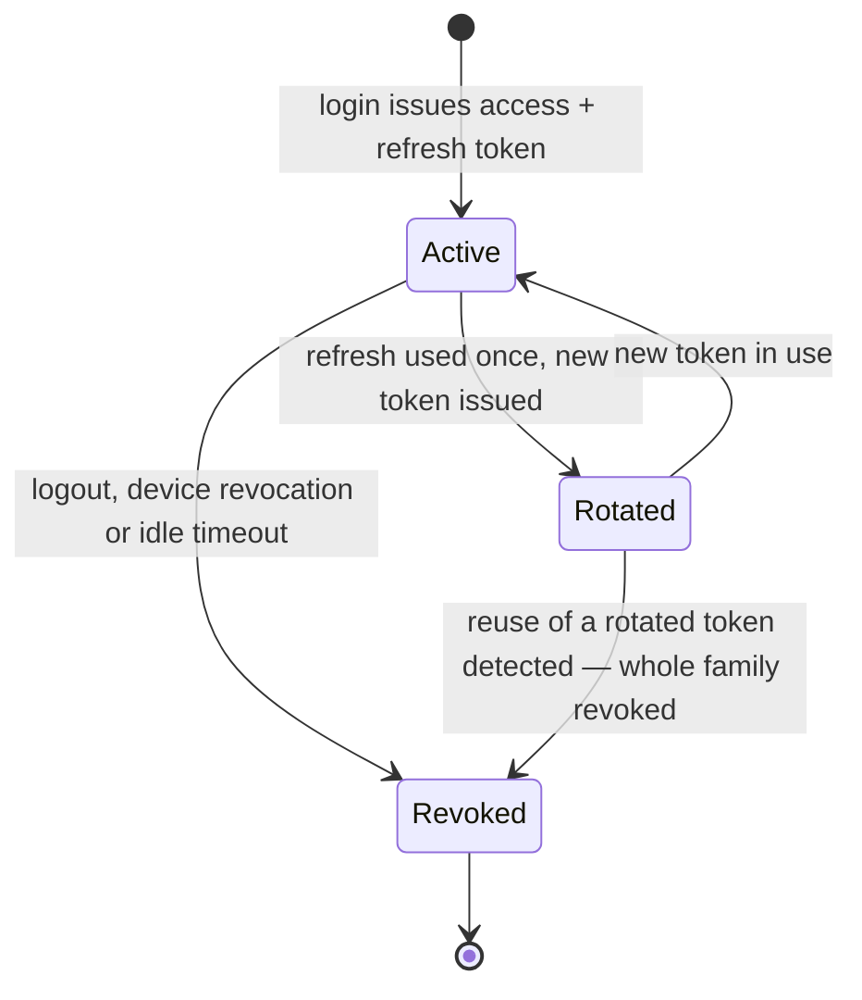

Reuse detection revokes the **entire family**, forcing re-authentication on every
device in that family.

## 13. Comment moderation

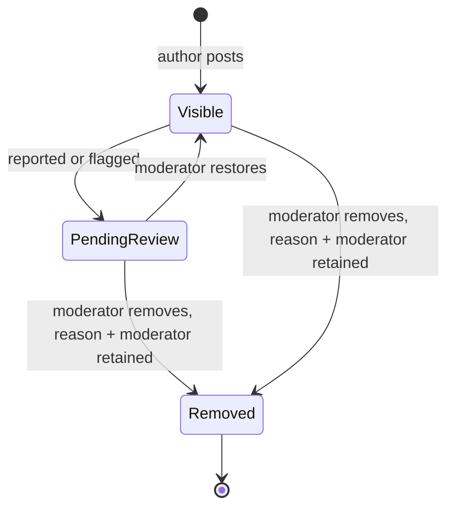

A removed comment is never deleted; its body, reason, moderator and timestamp
are retained for audit.
