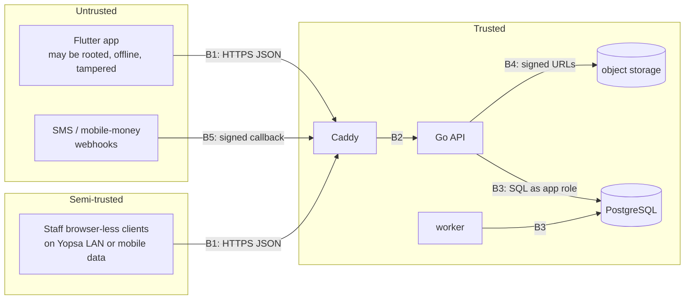

# Threat model

**Status:** P0 — delivered for approval. Re-reviewed at P9 (hardening sweep).
**Method:** STRIDE per trust boundary and per high-risk flow, with each
mitigation mapped to the test that proves it in
[TEST_PLAN.md](TEST_PLAN.md). This is a design document, not a substitute for
an independent penetration test.

## 1. Assets

| Asset | Why it matters |
|---|---|
| Members' money records (entries, receipts, allocations, postings) | Direct financial loss and loss of trust |
| Loan decisions and obligations | Credit risk, regulatory exposure |
| Personal data (name, phone, national ID reference, gender, attendance) | Uganda Data Protection and Privacy Act; member safety |
| Attendance and minutes | Basis of lending decisions and disputes |
| Evidence files (resolutions, receipts, photos) | Prove authority and receipt of funds |
| Credentials, TOTP secrets, refresh tokens, signing keys, encryption keys | Full compromise if leaked |
| Audit log | Detectability and accountability |
| Ranking and dashboard outputs | Misinformed management decisions |

## 2. Trust boundaries and entry points

| Boundary | What crosses it | Primary controls |
|---|---|---|
| B1 client → edge | JSON, bearer tokens, idempotency keys, files | TLS + pinning, rate limits, size limits, strict decoding, server-side validation |
| B2 edge → API | Trusted headers | No client-supplied actor headers; identity only from the verified token |
| B3 API → database | SQL as the unprivileged app role | RLS, least privilege, parameterised queries, triggers |
| B4 API → storage | Object keys, signed URLs | Short-lived signed URLs after authorisation, magic-byte validation, AV scan, EXIF strip |
| B5 provider → API | Webhook payloads | Signature, timestamp and replay checks; idempotent ingestion |

## 3. Payments and reconciliation

| ID | Threat | STRIDE | Impact | Mitigation | Test |
|---|---|---|---|---|---|
| TM-PAY-01 | Treasurer records an entry, then verifies it (or verifies a submission they recorded) | Elevation / Repudiation | Fictitious verified funds | SD-01/SD-02 in `rbac.CheckSeparation`; DB trigger on `receipt`/`allocation`; verifier must differ from every recorder | T-RBAC-02, T-PAY-06 |
| TM-PAY-02 | Shortage is hidden by spreading it across entries | Tampering | Members credited for money not received | Allocation total ≤ receipt amount (trigger); no auto-spread; partial verification requires per-entry evidence and a logged decision | T-PAY-01, T-PAY-04 |
| TM-PAY-03 | Double submission of the same entries inflates totals | Tampering | Overstated receipts and balances | `idempotency_key` unique per actor; `locked_hash` pins the entry set; same key + different payload → 409 | T-PAY-02 |
| TM-PAY-04 | Duplicate provider callback creates a second receipt/posting | Tampering | Double-credited funds | `UNIQUE (source, provider_ref)`; idempotent ingestion queue; posting keyed by allocation | T-PAY-03 |
| TM-PAY-05 | Locked or verified entries edited or deleted to hide a discrepancy | Tampering / Repudiation | Unrecoverable financial truth | Append-only tables, revoked UPDATE/DELETE for the app role, transition triggers, audit rows with before/after | T-PAY-05 |
| TM-PAY-06 | Posting failure is reported as success | Repudiation | Ledger and Pamoja disagree silently | Explicit `Posting pending` status + auto finance exception with owner and deadline; retries recorded | T-PAY-08 |
| TM-PAY-07 | Two verifiers act concurrently on one submission | Tampering | Double verification / double allocation | `SELECT … FOR UPDATE` on the submission, optimistic version, unique allocation per entry | T-PAY-09 |
| TM-PAY-08 | Cross-group or cross-branch read/write of payment data | Information disclosure / Elevation | Data leakage, unauthorised changes | Authorize scope check + RLS session variables; no client-supplied scope is trusted | T-PAY-10, T-RLS-01 |
| TM-PAY-09 | A screenshot is accepted as proof of payment | Spoofing | Verified funds that never arrived | Evidence record with source reference required; cash path with separated handover and deposit reconciliation | T-PAY-07 |
| TM-PAY-10 | Pending entries reduce an authoritative loan balance | Tampering | Understated arrears | Balances derive only from confirmed postings; report labels distinguish submitted/verified/posted | T-PAY-07b |

## 4. Group borrowing

| ID | Threat | STRIDE | Impact | Mitigation | Test |
|---|---|---|---|---|---|
| TM-LOAN-01 | An ordinary member binds the group to a loan | Spoofing / Elevation | Unauthorised debt | Authority record valid on the application date; only the `chairperson`/authorised representative may create and submit | T-LOAN-01 |
| TM-LOAN-02 | Approver approves their own application, or the appraising officer approves | Elevation | Unauthorised credit | SD-03; approver identity stored on the decision; authority limits from versioned config | T-LOAN-05 |
| TM-LOAN-03 | Disbursement confirmed by the approver | Elevation | Fraudulent disbursement | SD-04; only `verifier` (Finance) may disburse; external reference mandatory | T-LOAN-04 |
| TM-LOAN-04 | Approved loan counted as advanced before disbursement | Repudiation | Inflated portfolio reporting | "Loans advanced" counts confirmed disbursements only; dashboard test reconciles | T-LOAN-04b |
| TM-LOAN-05 | Terms taken from another product's pricing | Tampering | Mis-priced credit | Offer terms from the approved `loan_product` version only; version stored on the offer | T-LOAN-06 |
| TM-LOAN-06 | Guarantor rule bypassed above the threshold | Elevation | Unsecured exposure | Threshold from versioned config; service rejects above threshold without a checked guarantee | T-LOAN-02 |
| TM-LOAN-07 | Material change after approval not re-approved | Tampering | Unauthorised terms | Any material change resets the application to operations review | T-LOAN-03 |
| TM-LOAN-08 | Group loans and internal member loans double-counted | Tampering | Inflated exposure | Separate tables, workflows and reporting streams | T-LOAN-07 |

## 5. Authentication and sessions

| ID | Threat | STRIDE | Impact | Mitigation | Test |
|---|---|---|---|---|---|
| TM-AUTH-01 | Credential stuffing / brute force | Spoofing | Account takeover | Argon2id, per-IP and per-account rate limits, exponential backoff, generic errors, constant-time comparison | T-SEC-01 |
| TM-AUTH-02 | Stolen refresh token replayed | Spoofing | Persistent access | Rotation on every use, hashed storage, reuse detection revokes the family, device list and revocation | T-SEC-02 |
| TM-AUTH-03 | Staff account without MFA used for approval | Elevation | Unauthorised approval | TOTP mandatory for staff and approvers; step-up freshness before verify/approve/disburse/role change/correction/export | T-SEC-03 |
| TM-AUTH-04 | Account enumeration through login errors or timing | Information disclosure | Targeted attacks | Uniform errors and timing, no "user not found", hashed lookup keys | T-SEC-04 |
| TM-AUTH-05 | Stolen access token used after logout | Spoofing | Short unauthorised access | Access tokens ≤ 15 min; session id checked against the revocation list on sensitive actions | T-SEC-05 |
| TM-AUTH-06 | IT administrator grants themselves a financial role | Elevation | Full financial control | SD-10/SD-11 second administrator; matrix forbids financial actions for `it_admin`; grants audited | T-RBAC-03 |
| TM-AUTH-07 | JWT forged or replayed across environments | Spoofing | Unauthorised access | Signature, issuer, audience, expiry and session checks; per-environment keys; no `alg: none` | T-SEC-06 |
| TM-AUTH-08 | Shared phone leaks the previous user's data | Information disclosure | Member privacy breach | Per-user encrypted partitions, wipe on logout/remote revoke, short idle lock | T-SYNC-04 |

## 6. Uploads and evidence

| ID | Threat | STRIDE | Impact | Mitigation | Test |
|---|---|---|---|---|---|
| TM-UP-01 | Malware uploaded as evidence | Tampering | Workstation compromise | ClamAV scan before availability; rejected files quarantined and never served | T-SEC-07 |
| TM-UP-02 | Content-type spoofing (`.exe` as `.pdf`) | Tampering | Malware delivery, parser exploits | Magic-byte validation, extension allow-list, size limits, no execution, `Content-Disposition: attachment` | T-SEC-08 |
| TM-UP-03 | Private file reachable without authorisation | Information disclosure | Data breach | Private bucket, short-lived signed URLs issued only after `Authorize`, no public URLs | T-SEC-09 |
| TM-UP-04 | Location or device metadata leaked in photos | Information disclosure | Member safety | EXIF stripped by default | T-SEC-10 |
| TM-UP-05 | Oversized upload exhausts storage or memory | Denial of service | Service unavailability | Request and file size limits, streaming to storage, quotas | T-SEC-11 |
| TM-UP-06 | Photos used as proof of attendance | Repudiation | Falsified attendance | Photos are evidence only, never attendance; attendance requires check-in and register confirmation | T-ATT-04 |

## 7. Offline sync

| ID | Threat | STRIDE | Impact | Mitigation | Test |
|---|---|---|---|---|---|
| TM-SYNC-01 | Same draft synced twice creates two entries | Tampering | Duplicate financial records | Client UUID + idempotency key on the outbox event; server deduplicates | T-SYNC-01 |
| TM-SYNC-02 | Partial sync leaves inconsistent local state | Tampering | Missing or duplicated data | Per-item acknowledgement; atomic apply on the server; retry with backoff | T-SYNC-02 |
| TM-SYNC-03 | Clock skew lets a client backdate a payment | Repudiation | Misstated period | Server timestamps are authoritative; client time is advisory and recorded separately | T-SYNC-03 |
| TM-SYNC-04 | Revoked session keeps syncing | Elevation | Unauthorised writes | Every sync re-authenticates; revoked session → 401 and local wipe on next check-in | T-SYNC-04 |
| TM-SYNC-05 | Conflicting edits silently overwrite | Tampering | Lost corrections | Version comparison; conflict queued for human review | T-SYNC-05 |
| TM-SYNC-06 | Offline draft used for approval or verification | Elevation | Bypass of independent review | Verification, approval, disbursement and posting are server-only and never offered offline | T-SYNC-06 |
| TM-SYNC-07 | Local database stolen from device | Information disclosure | Member data breach | SQLCipher with a key in secure storage; wipe after repeated failed unlocks | T-SYNC-07 |

## 8. Platform, audit and reporting

| ID | Threat | STRIDE | Impact | Mitigation | Test |
|---|---|---|---|---|---|
| TM-AUD-01 | Audit rows edited or deleted to hide an action | Repudiation | No accountability | Append-only table, revoked UPDATE/DELETE, SHA-256 hash chain, verifier command, scheduled integrity check | T-AUD-01, T-AUD-02 |
| TM-AUD-02 | Audit chain broken by a direct database edit | Repudiation | Undetected tampering | Chain verification detects the first break; alert; documented escalation | T-AUD-02 |
| TM-IDEM-01 | Idempotency key reused with a different payload | Tampering | Wrong response replayed | Request hash stored; mismatch → 409 | T-PAY-02 |
| TM-EXPORT-01 | Unauthorised or unlogged export of member data | Information disclosure | Data breach | `export` action per module, audited with actor, scope, filter and row count; rate limited | T-RBAC-04 |
| TM-RANK-01 | Ranking presented as a credit score or public endorsement | Repudiation | Misuse of an internal tool | Fixed UI label, no public leaderboard, policy version and snapshot stored, management approval before activation | T-RANK-01 |
| TM-REPORT-01 | Dashboard mixes submitted, verified and posted values | Tampering | Misinformed decisions | Every card labels the three values; drill-down reconciles to source records | T-DASH-01 |
| TM-DOS-01 | Flood of requests exhausts the API | Denial of service | Outage during a meeting | Edge rate limits, per-account limits on sensitive routes, timeouts, body limits, connection pool caps | T-SEC-12 |

## 9. Residual risks (accepted, tracked)

| Risk | Why it remains | Owner action |
|---|---|---|
| SMS OTP delivery is not guaranteed | Provider and network reliability in rural Uganda | Assisted check-in and recovery-code path; monitor delivery failures |
| Shared phones leak via shoulder-surfing | Physical observation is outside software control | Short idle lock, screenshot protection, member education |
| A colluding treasurer and verifier can fabricate receipts | Two-person control reduces but cannot eliminate collusion | Independent reconciliation, spot audits, exception reporting |
| Alogsys API availability and cost unknown | Vendor contract not yet obtained | Document required endpoints; sandbox adapter until confirmed (A-023) |
| Clock skew on cheap Android devices | Device clocks drift | Server timestamps authoritative; advisory client time recorded |
| Independent penetration test not yet performed | Outside this build | Commission before real member data or money |

## 10. Out of scope for this threat model

- Physical security of the server room and staff devices (deployment checklist).
- Insider fraud by someone with database superuser access (mitigated by
  separation of roles, audit chain and independent review, not eliminated).
- Google Play / Apple policy risk (tracked in `STORE_POLICY_REGISTER.md`, P10).
